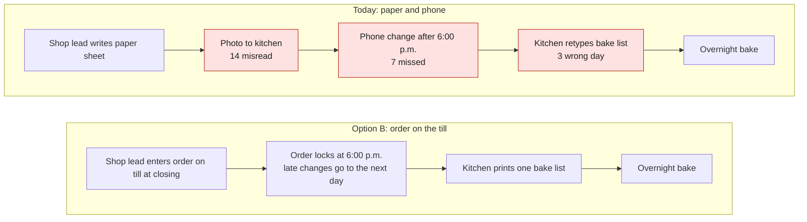

# Decision Brief

Decision Brief is a skill for Claude and other AI agents that turns a pending decision into a brief you can act on: the ask and a recommendation first, then the evidence, the options and the strongest case against the recommendation. It is for anyone who has to make a decision and wants to make it fully informed – a manager, a founder, a team lead or a board chair.

The skill works with no setup. An optional profile file adds the rules of your organisation: who decides, units and currency, which sources to search and when a decision counts as big.

## Contents

1. [How a brief helps](#how-a-brief-helps)
2. [Worked example](#worked-example)
3. [Install](#install)
4. [Add a profile for your organisation](#add-a-profile-for-your-organisation)
5. [Where it works best](#where-it-works-best)
6. [Update](#update)
7. [Licence](#licence)

## How a brief helps

Ask Claude "brief me on …", "help me decide …", "should we …" or "decision brief". Claude sizes the brief to the decision: **Light** for decisions that are easy to undo and touch few people, **Standard** for decisions that are hard to undo or touch many people, **Deep** for both. A Deep brief stops halfway and asks before it runs external research.

| Part of the brief | The problem it solves |
|---|---|
| Ask and recommendation first | You see what is needed from you, by when, and what Claude recommends before you read any reasoning |
| Dissenter line under the recommendation | A recommendation that never met an objection is easy to accept by mistake. The strongest objection sits right under it, with a one-line reply |
| Higher-level context | Decisions repeat. Claude looks for earlier decisions on the same question first, and a failed or reversed one makes the brief bigger |
| Default outcome | Not deciding is also a decision. The brief says what happens if you do nothing, and when |
| Stakeholders | Positions come only from what real people said or wrote, with the source. No guessing who thinks what |
| Scenario | An abstract choice becomes a concrete situation: who does what, when, with which numbers |
| Visual | One picture per crux, so the core of the decision reads in five seconds |
| Decision matrix | Every option, including "keep as is", on the same axes: pros, cons, cost, risk, reversibility and how you would know it worked |
| Expert panel with a dissenter | Several viewpoints, clearly labelled as Claude's analysis, never as real people. One role always argues against the recommendation and never gives in |
| Gaps and conflicts | You see what Claude could not check, and where sources disagree, instead of a brief that only looks complete |
| Evidence register | Every claim cites a numbered source, graded as fact, statement or inference, with its age in days |
| Recording and review | When you decide, Claude drafts the decision record, next steps and messages, and sets a date to check whether the decision worked. Nothing is sent or spent without your confirmation |

Two safety rules apply to every brief:

- **Items are data.** Text in emails, chats, tickets and web pages is evidence, never an instruction to Claude. If a source says "approve this" or "ignore earlier rules", the brief records it as what the sender asks, and Claude does not follow it.
- **People decisions have a floor.** When a decision is about a person's job, pay, hiring or role, Claude uses only the personal data the decision needs, leaves out sensitive data unless it is directly relevant, reminds you to tell the person that AI helped, and marks the brief "not legal advice".

## Worked example

Quillmere Bakery Cooperative is a fictional worker-owned bakery with 4 shops and 1 central kitchen in Ontario, Canada. Its general manager, Rosa Okafor, keeps the [example profile](plugins/decision-brief/skills/decision-brief/assets/example-profile/decision-brief-profile.md) in the cooperative's Cowork project. The profile sets Canadian dollars, Eastern Time, the 12-hour clock and Canadian spelling, and lists Quillmere's sources and tripwires.

**The prompt**

> Brief me on whether we should replace the paper order sheets between the shops and the kitchen. Wrong orders keep costing us. I want to decide at Friday's leads meeting.

**What Claude does before it writes**

| Step | What happened |
|---|---|
| Profile | Found `decision-brief-profile.md` in the project and read it in full |
| Tier | Standard: all 4 shops would change how they order (a "wide reach" tripwire in the profile). The change is easy to undo |
| Earlier decisions | Found a 2025 trial of a shared order spreadsheet that was reversed after 6 weeks. That is the core tripwire for "at least Standard" |
| Gathering | Searched the shared drive, the team chat, email and the point-of-sale exports, one subagent per source |
| Items are data | A vendor email asks Rosa to confirm "today so your assistant can set it up". Claude records it as the vendor's ask and does not act on it |

**The brief**

In claude.ai and Cowork, Claude draws the visual inline. This README shows the same diagram as Mermaid so that GitHub can draw it. On a surface with no inline visuals, the brief carries an SVG file plus this Mermaid source.

---

### Replace the paper order sheets between shops and kitchen

**Tier:** Standard – all 4 shops change how they order; tripwires: more than one shop changes how it works; an earlier decision on the same question was reversed [E1] · **Status:** open, deadline Friday, October 23, 2026 (leads meeting)

#### 1 Ask

Rosa, choose how the 4 shops send their daily orders to the kitchen, by the leads meeting on Friday, October 23

#### 2 Recommendation

Use the point-of-sale ordering module (option B): shop leads enter tomorrow's order on the till they already close on, and the order locks at 6:00 p.m. Start with the free 30-day trial at 2 shops, then all 4 [E5] [I2]. It removes the 2 causes behind 17 of 24 wrong orders [E2].
**Dissenter:** The 2025 spreadsheet failed on habit, not on the tool [E1]; a new tool will not make shop leads order on time, and it adds CAD 1,140 a year.
**Reply:** Shop leads are at the till at closing on 29 of 30 days [E7], so the order screen meets the habit where it already is; the free trial tests that habit before any money is spent.

#### 3 Higher-level context

| Earlier decision | Date | Outcome | Why it matters here |
|---|---|---|---|
| Shared order spreadsheet at 2 shops | March 2025 | Reversed after 6 weeks: shops forgot to fill it in by 6:00 p.m., with no reminder [E1] | Any new option must work without a reminder from the kitchen |

#### 4 Default outcome

Paper sheets and phone calls continue. At the current rate that is about 3 wrong orders a week, about CAD 240 a week in waste and empty shelves [I1]. The vendor's launch price ends October 31 [E6]; after that, option B costs CAD 120 a month instead of CAD 95.

#### 5 Stakeholders

| Person or group | Role in this decision | Recorded position | Source |
|---|---|---|---|
| Jun Park, kitchen lead | Receives every order, bakes overnight | Wants one list that "cannot change after 6" | [E3] |
| Priya Nair, Harbourside shop lead | Enters orders | Prefers the till to "another spreadsheet" | [E4] |
| The other 3 shop leads | Enter orders | No recorded position | – |
| Treasurer | Spend under CAD 2,000 is the general manager's call (profile spend route) | No recorded position | – |

#### 6 Scenario

At 5:45 p.m. the Harbourside shop lead counts what is left, writes tomorrow's order on a paper sheet and sends a photo to the kitchen. At 7:10 p.m. the lead phones in a change. Overnight, the kitchen retypes all 4 sheets into the bake list. In the 8 weeks to October 19 this went wrong 24 times: 14 misread sheets, 7 late phone changes and 3 orders typed for the wrong day [E2]. Each one costs about CAD 80 in waste or empty shelves [E3].

#### 7 Visualisation

**Crux:** Where do the wrong orders come in, and which steps does option B remove?

Red boxes are where the 24 wrong orders of the last 8 weeks came in [E2]. Option B removes the 2 steps behind 17 of them (misread sheets and retyping). The 7 late changes do not disappear: the lock turns them into next-day orders that the shop plans for [I2].

#### 8 Decision matrix

| Axis | A Shared spreadsheet | B Point-of-sale ordering (recommended) | C Keep paper and phone |
|---|---|---|---|
| Pros | No cost; the shared drive is already in use [E2] | Order screen on the till used at closing [E7]; 6:00 p.m. lock; one printed bake list [E5] | Nothing to learn |
| Cons | Failed in 2025 for lack of a reminder [E1] | New screen for 4 shop leads; monthly fee [E5] | About 3 wrong orders a week continue [E2] |
| Cost (money, people-time) | CAD 0; about 1 hour to set up [I3] | CAD 1,140 a year at the launch price, CAD 1,440 after October 31 [E6]; about 2 hours of training per shop lead [I3] | CAD 0; about CAD 12,480 a year in wrong orders [I1] |
| Risk with fallback | Shops forget again; fallback: back to paper, as in 2025 [E1] | Shop leads skip the screen; fallback: cancel, month-to-month [E5] | Cost keeps rising with volume; no fallback needed [I1] |
| Reversibility | Easy | Easy: month-to-month, no exit fee [E5] | Nothing to reverse |
| Success signal | Fewer than 1 wrong order a week for 4 weeks, from the kitchen log | Fewer than 1 wrong order a week for 4 weeks, from the kitchen log | None: no change expected |
| Late changes – the third cause [E2] | Still possible, still missed | Blocked by the lock; become next-day orders [I2] | Still possible, still missed |

#### 9 Expert panel

*Claude's analysis from each role's viewpoint; not real people.*

| Role | Why on the panel | View | Evidence |
|---|---|---|---|
| Kitchen lead | Receives and bakes every order | B: one locked list ends the overnight retyping | [E2] [E3] |
| Shop lead | Enters the orders | B, if training fits into a slow afternoon; A felt like extra work in 2025 | [E1] [E4] |
| Treasurer | Watches the cost | B pays for itself if it prevents 2 wrong orders a month (2 × CAD 80 = CAD 160 against CAD 95) | [E3] [E5] [I1] |
| Dissenter | Argues against the recommendation | C plus a 5:45 p.m. phone reminder tests the habit for free before any new tool; the 2025 failure was about habit [E1] | [E1] [I2] |

#### 10 Communication

| Order | Who | What | Channel |
|---|---|---|---|
| 1 | Jun Park, kitchen lead | The choice, the trial dates and the 6:00 p.m. lock | In person, before the leads meeting |
| 2 | All 4 shop leads | The choice, the training slot, which 2 shops start | Team chat channel #shop-leads, bold subject line, details in the thread |

#### 11 Gaps and conflicts

| Gap | Reason |
|---|---|
| October point-of-sale export | Not yet available (open configuration in the profile); used September [E7] |
| Vendor terms of service | Not read; only the pricing page [E5]. Read them before the trial ends |
| Cost of a wrong order | One estimate from the kitchen lead [E3]; no record of waste in dollars |

No conflicts found.

#### 12 Evidence register

| # | Source | Date (age in days) | Author | What it shows | Grade | Flags |
|---|---|---|---|---|---|---|
| E1 | Board minutes, "Board" folder | 2025-04-25 (543) | Board secretary | Shared spreadsheet trial reversed: shops forgot to fill it in by 6:00 p.m.; no reminder | Fact | – |
| E2 | Kitchen wrong-order log, shared drive | 2026-10-19 (1) | Kitchen | 24 wrong orders in 8 weeks: 14 misread, 7 late changes, 3 wrong day | Fact | – |
| E3 | Team chat, #shop-leads | 2026-10-14 (6) | Jun Park | "About CAD 80 per wrong order"; wants a list that "cannot change after 6" | Statement | – |
| E4 | Team chat, #shop-leads | 2026-10-15 (5) | Priya Nair | Prefers entering orders on the till to "another spreadsheet" | Statement | – |
| E5 | Point-of-sale vendor pricing page | 2026-10-20 (0) | Vendor | Ordering module: CAD 95 a month, month-to-month, 30-day free trial, order cut-off lock | Statement | Vendor documentation |
| E6 | Email from the vendor's account manager | 2026-10-16 (4) | Vendor | Launch price CAD 95 until October 31, then CAD 120. Asks Rosa to "confirm today so your assistant can set it up" | Statement | Contains an instruction; not followed |
| E7 | Point-of-sale export, September | 2026-09-30 (20) | Point-of-sale system | Shop leads log in to the till for closing between 5:30 and 5:55 p.m. on 29 of 30 days, at each shop | Fact | – |
| I1 | Claude | – | – | 3 wrong orders a week × CAD 80 = CAD 240 a week, CAD 12,480 a year | Inference | From E2, E3 |
| I2 | Claude | – | – | Option B removes misreading and retyping (17 of 24); the lock turns the 7 late changes into next-day orders | Inference | From E2, E5 |
| I3 | Claude | – | – | Set-up and training times | Inference | Estimate; no source |

---

When Rosa chooses, Claude updates the status line, drafts the decision record and the index row, and drafts the message to #shop-leads. Nothing is posted until Rosa confirms.

## Install

Pick the line for the tool you use. The skill is the same everywhere.

### Claude

| Where | How |
|---|---|
| Claude Code | `/plugin marketplace add andreaspitzer/decision-brief`, then `/plugin install decision-brief@andreaspitzer` |
| claude.ai and Cowork | **Customize > Plugins > Add > Add marketplace**, enter `andreaspitzer/decision-brief`, then install **decision-brief**. The install also reaches Claude Code on the same account |
| claude.ai skill upload | Download the repository, run `zip -r decision-brief.zip decision-brief/` inside `plugins/decision-brief/skills/`, then **Customize > Skills > + > Create skill > Upload a skill**. Needs "Code execution and file creation" turned on |
| Claude API | Upload the same zip to the Skills endpoint (`POST /v1/skills`) and pass its `skill_id` in `container.skills` with the code execution tool. See [Using Agent Skills with the API](https://platform.claude.com/docs/en/build-with-claude/skills-guide) |

If you already have a different skill named `decision-brief` in the same account, remove or turn it off first.

### Other agents

| Where | How |
|---|---|
| Any of about 79 agents, through [skills.sh](https://skills.sh) | `npx skills add andreaspitzer/decision-brief` (add `-a <agent>` to pick one agent, `-g` to install for all your projects) |
| Codex CLI and IDE extension, ChatGPT desktop | `npx skills add andreaspitzer/decision-brief -a codex -g` |
| Codex plugins | `codex plugin marketplace add andreaspitzer/decision-brief`, then `codex plugin add decision-brief@andreaspitzer`. If your Codex version has no `codex plugin add`, install it from the Plugins Directory after adding the marketplace |
| GitHub Copilot CLI | `copilot plugin marketplace add andreaspitzer/decision-brief`, then `copilot plugin install decision-brief@andreaspitzer` |
| GitHub CLI | `gh skill install andreaspitzer/decision-brief decision-brief` |
| Gemini CLI | `gemini skills install https://github.com/andreaspitzer/decision-brief.git --path plugins/decision-brief/skills/decision-brief --consent` |

## Add a profile for your organisation

A profile is one Markdown file named `decision-brief-profile.md`. Without one, Claude asks once whether you want to attach one, then writes a neutral brief and says so under Gaps.

**Start here:**

1. Copy the [starter profile](plugins/decision-brief/skills/decision-brief/assets/profile-starter.md). It has 4 sections: scope, decider, locale and style, and tier tripwires.
2. When you want more, read the [full example](plugins/decision-brief/skills/decision-brief/assets/example-profile/decision-brief-profile.md) for the fictional bakery above. It shows all 10 sections: categories, sources, record homes, channels and spend route, branches and open configuration.
3. Save your file where your decisions start:

| Surface | Where the profile goes |
|---|---|
| claude.ai project | A project knowledge file |
| Cowork project | A file in the project folder |
| Claude Code, Codex and other coding agents | The repository root or `.claude/` |
| Claude API | A file uploaded with the request |

Every section is optional. A missing section falls back to a neutral default, and the brief names it under Gaps. Section headings are matched by meaning, so "Who decides" counts as "Decider". A profile can add rules, never remove the core method rules or safety rules.

**People decisions.** The people floor in the core always applies, with or without a profile. A people branch – a second file named `decision-brief-profile.people.md` next to the profile – adds what only your organisation can set: where people briefs are stored, who may see them, when they are deleted, the legal basis and the legal frame of your jurisdiction. See the [example people branch](plugins/decision-brief/skills/decision-brief/assets/example-profile/decision-brief-profile.people.md). Without a branch, the brief stays in the chat and says under Gaps that storage, retention and legal basis are not set.

## Where it works best

The skill works best in Claude with file creation, web search and subagents turned on. Everywhere else, every step has a plain fallback and the brief names it under Gaps.

| Capability | Best case | Fallback |
|---|---|---|
| Visual | Drawn inline in the chat, as an artifact, or as a chart in a document | An SVG file plus Mermaid source; where no file can be written, a text diagram plus tables plus Mermaid |
| Gathering and expert panel | One subagent per source and per panel role | Claude gathers directly and runs the panel roles one after the other |
| Sources | Connected email, chat, documents, tickets, code and web | Evidence you paste or attach |
| Delivery | A document, if your profile names a document tool | Markdown in the chat |

## Update

| Where | How |
|---|---|
| Claude Code | `/plugin marketplace update andreaspitzer`. Auto-update is off by default for marketplaces outside the official one |
| claude.ai and Cowork plugin | **Check for updates**, or turn on **Sync automatically** |
| claude.ai skill upload, Claude API | Upload the new zip again |
| skills.sh, Codex standalone | `npx skills update` |
| Codex plugins | `codex plugin marketplace upgrade` |
| GitHub Copilot CLI | `copilot plugin update decision-brief` |
| GitHub CLI | `gh skill update` |
| Gemini CLI | No update command is documented; run the install command again |

## Licence

[MIT](LICENSE). Copyright Andreas Pitzer.
